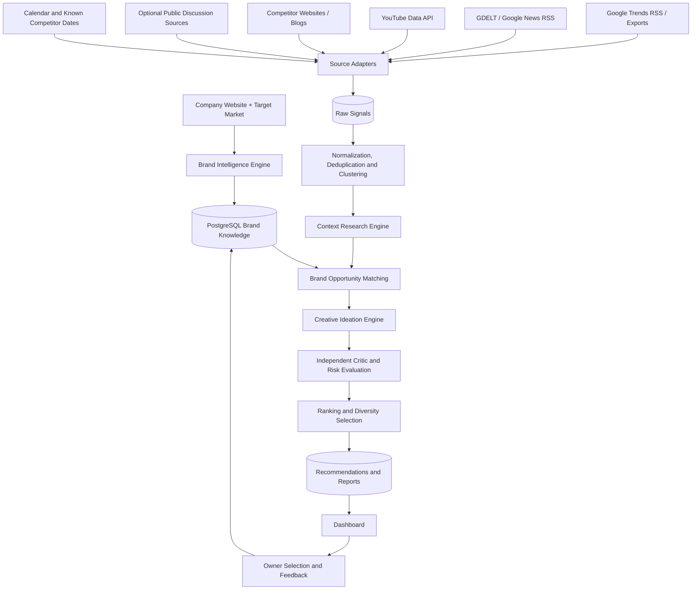
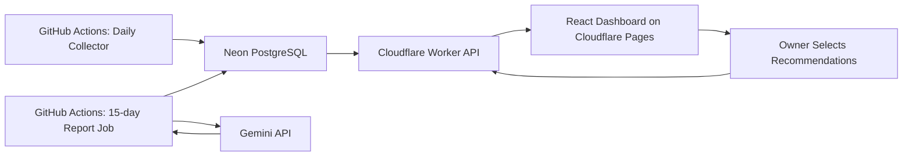

# Brand Intelligence & Creative Content Recommendation Engine

> **A low-cost, market-first AI system that researches a company's market, competitors, cultural moments, and audience signals, then recommends what the brand should post on social media.**

The system is a **marketing intelligence and creative opportunity engine**. It is not an automatic caption generator, image/video generator, social media scheduler, or publishing bot.

Its central question is:

> **What's happening around this brand, and how can the brand turn it into a relevant, original social media moment?**

---

## 1. Product goal

The system should help a business remain relevant and active on social media by identifying useful marketing opportunities. Examples include:

- A brand joining a relevant Gen Z or cultural conversation.
- A playful, respectful interaction inspired by a competitor's public campaign or milestone.
- A festival-related idea that connects naturally with the company's products.
- A product being presented through a relatable everyday situation rather than a discount.
- An educational or community-oriented post based on a customer problem.
- A timely reaction to a relevant industry event.

The goal is **not** to recommend offers and discounts by default. The system should find a variety of brand-appropriate creative opportunities.

### Expected output

Every 15 days, produce approximately **5–6 strong recommendations**. Each recommendation explains:

1. What happened or what opportunity was identified.
2. Why it matters now.
3. Why it is relevant to this specific brand and its audience.
4. What the brand should post—the creative concept, not a finished asset.
5. Which platform and format may be appropriate.
6. What evidence supports the recommendation.
7. How urgent the opportunity is and what risks it carries.

The system must not force six recommendations. Three strong ideas are better than six generic ones. Evergreen ideas may fill gaps when there are not enough strong timely opportunities, but they must be labelled as evergreen.

---

## 2. Scope and non-goals

### Included in V1

- Website-driven business and product understanding.
- Developer-seeded initial knowledge about the company, when available.
- Automatic discovery and research of likely direct and adjacent competitors, with confidence and evidence.
- Public market, trend, news, cultural, seasonal, and competitor-signal collection.
- Signal deduplication, clustering, freshness, and momentum analysis.
- Context research to understand why an event or topic matters.
- Brand-opportunity matching.
- Multiple creative angles per promising opportunity.
- Independent criticism, risk checks, diversity controls, and ranking.
- Evidence-backed 15-day recommendation reports.
- Optional alerts for unusually time-sensitive opportunities.
- Owner selection and feedback **only after the recommendations are presented**.

### Not included in V1

- Generating images, videos, reels, or other finished creative assets.
- Writing complete captions as the main deliverable.
- Automatically scheduling or publishing to Instagram, X, or other platforms.
- Requiring previous company posts or campaign-performance history.
- Running local ML models, embeddings, cross-encoders, or vector databases.
- Paid social-listening subscriptions as a requirement.

### Important operating assumption

The developer provides the company website and target market/country, and can seed known business context or competitor candidates from initial research. This is not a recurring owner questionnaire. The owner is not involved in research, profile construction, competitor discovery, or report generation; the owner only reviews the final shortlist and decides what to execute.

---

## 3. User journey

```text
Developer provides company website + target country
                    |
                    v
       Website and business analysis
                    |
                    v
       Persistent brand knowledge profile
                    |
                    v
      Competitor and market understanding
                    |
                    v
       Daily public-signal collection
                    |
                    v
       Signal normalization and clustering
                    |
                    v
       Context and event understanding
                    |
                    v
       Brand-opportunity matching
                    |
                    v
       Creative ideation (multiple angles)
                    |
                    v
       Independent critic + safety checks
                    |
                    v
       Ranked 15-day recommendation report
                    |
                    v
           Owner selects ideas
```

There is no requirement for the owner to approve the brand profile or supply competitor data. If the developer already knows competitors, they can be seeded to improve accuracy; otherwise, the system attempts discovery and marks uncertain candidates accordingly.

---

## 4. High-level architecture

The application should be a **single TypeScript modular monolith** with separate scheduled jobs. It does not need seven microservices or a complicated multi-agent framework.



### Main modules

| Module | Responsibility |
|---|---|
| Brand Intelligence | Crawl the company website and create a structured business profile. |
| Competitor Research | Identify and monitor direct and adjacent competitors through accessible public sources. |
| Source Adapters | Fetch data from individual research providers and convert it to a common format. |
| Signal Intelligence | Normalize, deduplicate, cluster, and calculate freshness/momentum indicators. |
| Context Research | Explain what happened, why it matters, who is involved, and what is still uncertain. |
| Opportunity Matching | Decide whether the event has a natural connection to the brand and its audience. |
| Creative Ideation | Produce different, specific marketing concepts for suitable opportunities. |
| Critic and Evaluator | Challenge generic, repetitive, unsupported, copied, or risky ideas. |
| Ranking | Select a varied, evidence-backed shortlist. |
| Report API and Dashboard | Present recommendations, evidence, urgency, and owner decisions. |

---

## 5. Brand Intelligence Engine

### 5.1 Website ingestion

Use lightweight HTML fetching and parsing as the default:

- Native `fetch()` for page retrieval.
- Cheerio for HTML parsing.
- Sitemap discovery for relevant pages.
- JSON-LD extraction for `Organization`, `Product`, `Article`, and related structured data.
- SHA-256 hashes to detect page changes.
- Playwright only as a fallback for a small number of JavaScript-rendered pages.

Recommended crawl order:

1. Homepage.
2. `robots.txt` and sitemap discovery.
3. About/company pages.
4. Product and category pages.
5. Services and pricing pages.
6. Blog, news, and campaign pages.
7. FAQ, shipping, and contact pages where relevant.

The first crawl should be bounded (for example, approximately 20–30 high-value pages) rather than crawling every URL indiscriminately.

**Security and crawler requirements:**

- Respect website terms, robots directives, and rate limits.
- Restrict crawling to approved domains and safe redirects.
- Block localhost, private IP ranges, metadata endpoints, and unsafe URL schemes to prevent SSRF.
- Apply timeouts, response-size limits, and content-type checks.
- Do not bypass login walls, CAPTCHAs, or access controls.
- Store the page URL, retrieval time, content hash, and extraction status.

### 5.2 Extracted business information

The system should extract:

- Business name and description.
- Industry and business category.
- Products and services.
- Product attributes and verified claims.
- Price positioning, where public information exists.
- Geographic markets and distribution areas.
- Potential customer segments.
- Website language and communication style.
- Unique selling propositions explicitly supported by the website.
- Existing public social/profile links.

### 5.3 Brand profile

An LLM can convert extracted evidence into a structured profile. Example:

```json
{
  "business_name": "Example Lighting",
  "industry": "Consumer electronics",
  "category": "LED lighting",
  "market": "India",
  "products": ["LED bulbs", "Decorative lights"],
  "audience_segments": ["Households", "Retail customers", "Electricians"],
  "positioning": "Affordable and reliable lighting",
  "brand_tone": ["Friendly", "Practical", "Informative"],
  "potential_content_pillars": [
    "Festivals",
    "Home improvement",
    "Everyday humour",
    "Lighting education"
  ]
}
```

This is illustrative. The profile must distinguish facts from assumptions.

Every fact should include:

- `value`
- `fact_type`: `verified`, `inferred`, or `unknown`
- `source_url` (when available)
- `observed_at`
- `confidence_basis`

The LLM must not convert an inference into a verified claim. For example, a website may describe affordable products, but it may not prove the actual age or income distribution of customers.

### 5.4 Competitor discovery

Competitor discovery is useful but should not be treated as perfectly automatic. Candidate discovery can use:

- Product and category keywords extracted from the website.
- Search/news results available through selected public sources.
- GDELT and Google News queries.
- YouTube search and known industry channels.
- Public industry directories and company websites.
- Optional competitor names seeded by the developer.

Classify candidates as:

- **Direct competitor:** Similar products competing for similar customers.
- **Indirect competitor:** Different products solving a similar customer problem.
- **Adjacent brand:** Different industry, but useful for creative or audience inspiration.

Store the reason for the classification and supporting source links. Do not assume every search result is a competitor. If evidence is weak, mark the candidate as uncertain.

---

## 6. Market Research Engine and data sources

Use several independent sources. No single free source provides complete visibility into Indian social-media culture.

| Source | What it contributes | V1 status |
|---|---|---|
| Google Trends Trending Now RSS / CSV | Search-interest signals, rising queries, seasonal topics | Core |
| GDELT | News coverage, industry developments, cultural events | Core |
| Google News RSS | Company announcements, industry stories, current events | Core |
| YouTube Data API | Known competitor channel uploads, titles, dates, visible metrics | Core |
| Competitor websites/blogs | Product launches, public campaigns, offers, positioning | Core |
| Bluesky public API | Additional public discussions | Optional |
| Meta Ad Library | Public advertising examples | Supporting/manual |
| Instagram public content | Limited official access and manual references | Limited |
| X API | Public conversation research subject to API pricing | Not in free baseline |
| Reddit API | Customer discussions, subject to commercial permission and terms | Not in free baseline |

### 6.1 Google Trends

Use Google Trends for:

- India and relevant regional trending topics.
- Tracked product/category keywords.
- Seasonal search patterns.
- Rising and related queries.

Google Trends scores are normalized relative interest (typically 0–100), not absolute search counts and not social engagement. Do not label a topic viral merely because its search score increased.

Use RSS/CSV or permitted access methods. Do not make the system depend on restricted alpha API access or fragile scraping of undocumented endpoints.

### 6.2 GDELT and Google News

Use these to discover:

- Cultural and industry events.
- Company announcements.
- Public brand mentions.
- Product/category developments.
- Developing news narratives.

News volume is a signal of media coverage, not proof of social-media virality. Retrieve a small number of relevant articles for each promising event and preserve links and dates.

### 6.3 YouTube Data API

For competitor monitoring:

1. Discover a competitor channel.
2. Save its channel ID and uploads playlist ID.
3. Retrieve recent uploads using playlist methods.
4. Fetch video metadata and permitted public statistics.
5. Store observations over time to compare changes.

Avoid repeatedly searching for channels that are already known. API quotas and method costs must be checked against current provider documentation during implementation.

### 6.4 Competitor websites

Monitor accessible official:

- Product pages.
- Blogs and news pages.
- Announcement pages.
- Campaign landing pages.
- RSS feeds and sitemaps.

This supports observable competitor intelligence without claiming unrestricted access to organic Instagram or X activity.

### 6.5 Optional sources

Bluesky can add public discussion signals. Meta Ad Library can provide advertising examples through public browsing and permitted tools. Reddit should not be used as a default free commercial data source without checking and obtaining the required permission. X should not be a core dependency for a strict zero-cost version.

### 6.6 Source registry

Every connector should be configured through a source registry rather than hardcoded throughout the application. Store:

- Source type and provider.
- Query or account/channel identifier.
- Region and language.
- Collection frequency.
- Last successful run.
- Rate-limit and error status.
- Enabled/disabled state.

This lets providers be replaced without redesigning the intelligence pipeline.

---

## 7. Signal Intelligence Engine

This stage is primarily deterministic code. It should reduce noise before the system uses LLM calls.

### 7.1 Canonical signal schema

All source adapters should normalize their records into a common structure:

```json
{
  "source": "google_news",
  "source_type": "news",
  "title": "Example market event",
  "url": "https://example.com/article",
  "published_at": "2026-11-10T08:00:00Z",
  "fetched_at": "2026-11-10T09:00:00Z",
  "country": "IN",
  "language": "en",
  "entities": [],
  "keywords": [],
  "excerpt": "Short extracted text"
}
```

Preserve the original source record and the normalized version. Do not replace source evidence with an LLM summary.

### 7.2 Deduplication

Use:

- Canonical URL matching.
- Normalized title comparison.
- Publisher and timestamp checks.
- Entity and keyword overlap.
- PostgreSQL full-text search and `pg_trgm` similarity.

No vector database is required for the expected V1 volume.

### 7.3 Event clustering

Group multiple signals that describe the same underlying event. For example, several news articles, a YouTube video, and a competitor announcement may belong to one event cluster.

Store:

- Cluster title and summary.
- Signal IDs.
- First and last observed time.
- Unique source count.
- Source diversity.
- Related entities and keywords.
- Cluster status.

### 7.4 Momentum and freshness

Calculate observable indicators:

- First occurrence.
- Last occurrence.
- Mentions in recent time windows.
- Change relative to the previous window.
- Number of independent sources.
- Source diversity.
- Search-interest movement when comparable data exists.

Example:

| Window | Independent mentions |
|---|---:|
| Previous 7 days | 3 |
| Latest 7 days | 12 |

This indicates increased observed coverage, not necessarily viral social engagement.

### 7.5 Trend phase and expiry

Possible states:

- `EMERGING`
- `GROWING`
- `PEAK`
- `DECLINING`
- `EXPIRED`
- `EVERGREEN`

An estimated expiry time should be updated as new evidence arrives. The model may suggest a lifespan, but code should enforce maximum age and freshness rules based on source timestamps.

**Output:** event clusters with source references, freshness, observable momentum, and uncertainty.

---

## 8. Context Research Engine

This is the first major LLM reasoning stage.

For promising clusters, retrieve a bounded set of independent sources and prepare a structured context pack. Do not send every collected article to the model.

The context pack must answer:

| Question | Expected output |
|---|---|
| What happened? | Factual event explanation |
| Why are people discussing it? | Supported context, not a guess |
| Who is participating? | Brands, creators, audiences, public entities where identifiable |
| What is the mood? | Humorous, celebratory, serious, critical, neutral, etc. |
| Is it growing or fading? | Evidence-based interpretation |
| How long may it remain useful? | Estimated opportunity window |
| What is sensitive? | Potential cultural, political, legal, or reputational risk |
| What is unknown? | Explicit gaps and contradictions |

Example output:

```json
{
  "event_id": "event_001",
  "event_summary": "Verified event summary",
  "why_it_matters": "Explanation supported by sources",
  "participating_entities": [],
  "audience_context": [],
  "sentiment": "humorous",
  "trend_phase": "growing",
  "sensitivity": "low",
  "estimated_expiry": "2026-11-14",
  "evidence_ids": [],
  "unknowns": []
}
```

The model must not invent why a trend is popular. If the evidence does not explain the context, it should say so and lower the opportunity's priority.

---

## 9. Brand Opportunity Matching Engine

This stage evaluates whether an event makes sense for the target company.

Inputs:

1. Saved brand profile and product facts.
2. Audience and geographic market assumptions.
3. Event context pack.
4. Competitor observations.
5. Relevant calendar events.

Questions:

- Is this event relevant to the brand's audience?
- Does a product, customer problem, brand value, or category naturally connect to it?
- Can the brand contribute something useful, entertaining, or distinctive?
- Is the proposed angle already saturated?
- Is a competitor already strongly associated with the idea?
- Would participation feel forced or opportunistic?
- Is there a material reputational or factual risk?

Example:

- Event: Diwali is approaching.
- Brand: LED bulb company.
- Natural connection: Light, homes, decoration, family, energy use.
- Possible idea: A creative concept showing how different corners of a home become more welcoming with suitable lighting.
- Non-goal: Automatically suggesting a discount.

The same festival should produce different ideas for a clothing brand, restaurant, gift company, and software business.

### Opportunity categories

Categories are a guide, not a quota:

1. Cultural and moment marketing.
2. Competitor interaction or response.
3. Festival and seasonal marketing.
4. Product-context storytelling.
5. Audience problems and conversations.
6. Educational content.
7. Community participation.
8. Evergreen brand personality.

The engine should be able to reject an event entirely if no natural connection exists.

---

## 10. Creative Ideation Engine

For each strong opportunity, generate multiple distinct creative routes. Usually 2–3 candidates per promising opportunity are sufficient.

Possible routes:

- **Culture-jacking:** Connect a current cultural moment to the brand naturally.
- **Competitive/reactive:** Develop an original response to a competitor's public campaign or milestone.
- **Product metaphor:** Connect the product to a relatable everyday situation.
- **Relatable humour:** Use a customer experience or familiar problem.
- **Seasonal storytelling:** Connect a festival or occasion to the brand.
- **Community engagement:** Invite participation or conversation.
- **Education:** Explain something useful about the product category.
- **Brand personality:** Build recall through a memorable point of view.

The system must not copy a competitor's artwork, wording, or distinctive execution. It can learn from the marketing mechanism and create a different brand-specific idea.

### Candidate idea schema

```json
{
  "opportunity_id": "opp_001",
  "creative_routes": [
    {
      "route": "humorous",
      "concept": "Specific brand-related concept",
      "reasoning": "Why the connection is natural",
      "suggested_platform": "Instagram",
      "suggested_format": "Meme or carousel",
      "objective": "Brand awareness"
    },
    {
      "route": "product_storytelling",
      "concept": "Alternative concept",
      "reasoning": "Why it is relevant",
      "suggested_platform": "Instagram",
      "suggested_format": "Carousel",
      "objective": "Product discovery"
    }
  ]
}
```

The output is a creative direction, not a finished caption, image, video, or publishing instruction.

---

## 11. Independent Critic, Safety, and Ranking

The generator should not approve all of its own ideas. A separate evaluation pass is mandatory.

### Critic checklist

- Could this idea be posted by almost any company? If yes, it is too generic.
- Is the product connection natural?
- Does the concept understand the cultural context?
- Is it too similar to a competitor's existing campaign?
- Is the event still relevant?
- Can a real marketing team execute it?
- Are factual claims supported?
- Is there a sensitivity or reputational issue?
- Does it repeat a recent recommendation?

Possible verdicts:

- `ACCEPT`
- `REVISE`
- `REJECT`

A different model can be used for the critic when affordable. If the same model is used, it must receive a separate rubric and structured task; this is useful but not fully independent evaluation.

### Evidence and quality scoring

Keep deterministic evidence metrics separate from subjective creative judgements.

| Computed by code | Evaluated through an AI rubric |
|---|---|
| Source recency | Brand fit |
| Independent source count | Audience relevance |
| Source diversity | Creative usefulness |
| Observable search/mention momentum | Distinctiveness |
| Event first/last seen | Execution feasibility |
| Evidence completeness | Cultural appropriateness |

Do not trust an LLM's self-reported confidence as calibrated probability. Derive evidence confidence from source quality, independent corroboration, recency, and completeness.

An initial priority score can combine normalized metrics, but its weights must be treated as heuristics and calibrated through evaluation. If a metric is unavailable, mark it unknown and renormalize rather than silently treating missing data as zero.

### Risk handling

| Risk | Action |
|---|---|
| Safe | Eligible for recommendation |
| Caution | Clearly flag for human judgement |
| Blocked | Reject |

Reject concepts that exploit tragedies, promote hatred, make unsupported product claims, misuse sensitive cultural or religious events, or create material legal/reputational risk.

### Diversity selection

The final shortlist should not contain five versions of the same idea. Apply a diversity penalty across:

- Opportunity category.
- Creative route.
- Target audience.
- Product or service promoted.
- Platform/format.
- Event cluster.

Do not force category quotas. If only three strong ideas pass the quality bar, show three.

---

## 12. Final recommendation format

Every recommendation card should include:

| Field | Description |
|---|---|
| Title | Short opportunity name |
| Category | Cultural, competitor, seasonal, product-context, evergreen, etc. |
| What happened | Event or market observation |
| Why now | Timing and context |
| Brand connection | Why this particular company can participate |
| What to post | Specific creative concept or direction |
| Suggested platform | Instagram, X, LinkedIn, etc., where suitable |
| Suggested format | Meme, carousel, static post, reel concept, text post, poll, etc. |
| Objective | Awareness, engagement, education, product discovery, etc. |
| Evidence | Supporting source links and dates |
| Urgency | Estimated useful window |
| Risk | Safe, caution, or blocked |
| Evidence confidence | Derived from source quality and corroboration |
| Execution note | What the human creative team should make or communicate |

No image/video generation, finished caption, or auto-publishing is required.

---

## 13. Daily collection and 15-day recommendation workflow

There are two scheduled paths.

### Daily collector (no broad LLM usage)

1. Fetch configured Trends feeds/exports.
2. Fetch GDELT and Google News results.
3. Check competitor websites and public feeds.
4. Fetch recent uploads from known YouTube channels.
5. Normalize and validate source records.
6. Deduplicate and update event clusters.
7. Recalculate freshness and observable momentum.
8. Save results and source-run status.
9. Identify unusually urgent candidates using deterministic thresholds.

### Fortnightly report runner (AI reasoning)

1. Load the brand profile and current product facts.
2. Retrieve new and still-relevant signal clusters.
3. Remove expired or weak candidates.
4. Prepare bounded context packs with supporting sources.
5. Match events to the brand and audience.
6. Generate multiple creative routes for promising opportunities.
7. Run critic, risk, evidence, and repetition checks.
8. Rank and diversify candidates.
9. Produce approximately 5–6 recommendations if enough pass the quality threshold.
10. Save the report and publish it to the dashboard.

### Optional urgent-moment lane

A 15-day cycle can miss short-lived cultural moments. An optional lightweight daily rule can flag an unusually strong, time-sensitive candidate between reports. It should only trigger when evidence, brand fit, and risk thresholds are met. It may produce one separate alert rather than a full report.

If this lane is disabled, the system must accept that some short-lived opportunities will be missed.

### Reliability requirements

- Idempotency keys for jobs and source records.
- Bounded retries and exponential backoff.
- Per-source timeouts and request limits.
- Job checkpoints so failed reports can resume.
- Overlapping collection windows to recover missed scheduled runs.
- Source-level errors must not stop the complete research run.
- Dead-letter/error records for repeated failures.
- Log token usage and cost per report.

---

## 14. Database design

Recommended PostgreSQL tables:

| Table | Responsibility |
|---|---|
| `brand_profiles` | Business identity, market, and positioning |
| `brand_facts` | Verified/inferred facts with provenance |
| `products` | Products, categories, attributes, and verified claims |
| `audience_segments` | Audience hypotheses and relevant customer groups |
| `competitors` | Direct and adjacent competitors |
| `competitor_sources` | Official websites, channels, feeds, and public references |
| `competitor_observations` | Publicly observed campaigns, products, announcements, and activities |
| `calendar_events` | Festivals, company milestones, competitor dates, and industry occasions |
| `source_registry` | Configured providers, queries, accounts, and collection settings |
| `source_runs` | Collection run status, quotas, and errors |
| `raw_signals` | Original source metadata and bounded excerpts |
| `signal_clusters` | Deduplicated events and conversations |
| `cluster_evidence` | Many-to-many relationship between clusters and source signals |
| `context_packs` | Structured event explanations and unknowns |
| `opportunity_candidates` | Event-to-brand matches |
| `idea_candidates` | Alternative creative concepts |
| `recommendations` | Final selected concepts |
| `evidence_links` | Recommendation-to-source provenance |
| `report_runs` | Fortnightly report execution history |
| `owner_feedback` | Final selections, rejections, and optional reasons |
| `job_checkpoints` | Idempotency, retries, and resumable processing |

The company does not need a historical content archive. Store the system's own past recommendations so it can avoid repeating its own output. Public campaign examples discovered during market research can be stored as external market references.

---

## 15. Technology stack

Recommended low-cost V1 stack:

| Layer | Technology | Reason |
|---|---|---|
| Language | TypeScript | Typed data contracts across pipeline stages |
| Backend/research runner | Node.js | Lightweight scheduled jobs and source adapters |
| Frontend | React + Vite | Simple report dashboard |
| Database | Neon PostgreSQL | Persistent relational research storage |
| ORM | Drizzle ORM | Typed SQL and schema management |
| Collection scheduler | GitHub Actions | Scheduled execution without an always-on server |
| Website extraction | Fetch + Cheerio | Lightweight HTML retrieval and parsing |
| Dynamic page fallback | Playwright | Only for a small number of JS-heavy pages |
| News research | GDELT + Google News RSS | Public news/event signals |
| Trend research | Google Trends RSS/CSV | Search-interest signals |
| Video research | YouTube Data API | Known competitor channel monitoring |
| AI reasoning | Gemini API | External model; no local model loaded |
| Dashboard hosting | Cloudflare Pages | Static frontend hosting |
| Dashboard API | Cloudflare Workers | Lightweight read/write API only |

### Why this is RAM-efficient

Do not install or deploy:

- PyTorch.
- Transformers.
- Cross-encoder models.
- NLI models.
- Local embedding models.
- FAISS or Qdrant.
- GPU inference infrastructure.

The backend performs HTTP requests, text cleanup, SQL operations, and bounded LLM API calls. Model inference happens outside the application.

Use Playwright only when ordinary HTML extraction is insufficient. Do not keep browsers running or render every competitor page through a browser.

### Why not microservices?

The workload is a low-volume, scheduled research pipeline. A modular monolith with separate job entry points is easier to test, deploy, and maintain. Microservices, Redis, BullMQ, and always-running workers would add operational cost without a demonstrated need.

---

## 16. Deployment architecture



### Deployment responsibilities

**GitHub Actions**

- Runs daily collection jobs.
- Runs the fortnightly report workflow.
- Stores no durable business data on the runner.
- Reads secrets from repository/environment secrets.
- Writes all durable results to PostgreSQL.

**Neon PostgreSQL**

- Stores brand knowledge and product facts.
- Stores competitors and sources.
- Stores raw signals, clusters, and context packs.
- Stores recommendations and feedback.
- Stores job state and checkpoints.

**Cloudflare Worker API**

- Authenticates dashboard requests.
- Reads completed reports.
- Returns recommendation details and source links.
- Saves owner decisions and feedback.
- Does not execute the complete research pipeline inside a request.

**Cloudflare Pages**

- Hosts the static React dashboard.
- Displays completed reports, evidence, and owner selection controls.

The frontend must never contain database credentials or LLM API keys.

### GitHub Actions reliability caveat

Scheduled workflows are suitable for periodic collection, but they are not a real-time scheduler and can be delayed. Jobs must be idempotent and recover missed windows. If the business later requires guaranteed timing or more frequent monitoring, move scheduling to a managed scheduler/worker with a suitable paid reliability tier.

---

## 17. Cost strategy

The initial target is **near-zero infrastructure cost with low, controlled AI API usage**. It is not a promise of permanently free commercial operation.

| Component | Initial approach | Cost expectation |
|---|---|---|
| Source collection | Public feeds and free quotas | Free within limits |
| Database | Neon free tier | Free within limits |
| Scheduled jobs | GitHub Actions included minutes | Free within limits |
| Frontend | Cloudflare Pages | Free within limits |
| API | Cloudflare Workers free allowance | Free within limits |
| AI | Gemini free tier where appropriate | Free within model limits; paid usage may be required |
| Social listening | No paid listening platform in V1 | Not included |
| Image/video generation | Not included | No generation cost |
| Publishing APIs | Not included | No publishing cost |

### AI cost controls

- Collect and filter data before LLM calls.
- Deduplicate articles and videos.
- Use small evidence packs per event.
- Batch context summarization.
- Generate multiple ideas only for high-quality opportunities.
- Use an economical model for routine tasks.
- Reserve stronger model calls for final ideation/criticism where needed.
- Enforce maximum input/output tokens and retry limits.
- Log token use and estimated cost per report.

### Privacy note

Free hosted-model tiers can have different data-use terms from paid tiers. Use free-tier processing only for public, non-confidential information unless the provider's current terms explicitly permit the intended data. Do not send confidential company strategy, customer records, or unreleased plans to a free tier without checking its data-use policy.

---

## 18. Limitations and honest expectations

This system is designed to be the best practical low-cost starting point for one company. It is not equivalent to an enterprise social-listening platform.

| Limitation | Why it exists | Mitigation |
|---|---|---|
| Incomplete Instagram/X competitor monitoring | No unrestricted free API provides all organic public competitor content | Use accessible official sources, public references, news, YouTube, and websites |
| Missed memes and niche trends | Public sources do not cover every Indian social community | Combine independent sources; treat coverage as partial |
| Search interest is not virality | Google Trends measures relative search behaviour, not social engagement | Corroborate with public discussions and coverage |
| Competitor performance is unknown | Public posts rarely expose impressions, conversions, or private analytics | Report observable activity, not assumed success |
| Brand personality may be approximate | A website may not reveal social-media tone | Treat inferred tone as provisional and use conservative defaults |
| Creative quality varies | AI can misunderstand culture or produce generic ideas | Independent critic, evidence checks, and owner selection |
| Trends may expire before a report | The reporting cycle is 15 days | Daily collection and optional urgent-moment alerts |
| Free API limits can change | Providers control quotas and eligibility | Caching, backoff, fallbacks, and replaceable adapters |
| Website extraction may be incomplete | JavaScript rendering, access restrictions, and inconsistent markup | Playwright fallback and extraction-status reporting |
| News coverage is not social engagement | News APIs measure news coverage | Label signals accurately and avoid viral claims without evidence |

### Claims the system must not make

- Do not call a topic viral based only on one search trend or several syndicated articles.
- Do not claim a competitor's campaign succeeded without performance evidence.
- Do not invent competitor offers, campaign dates, or social metrics.
- Do not imply complete Instagram/X monitoring.
- Do not predict that a post will go viral or guarantee engagement/sales.
- Do not present inferred audience demographics as verified facts.

---

## 19. Evaluation and testing strategy

The product's value is recommendation quality, not the number of API integrations or captions generated.

### 19.1 Historical benchmark

Create a dated benchmark of approximately 20–30 real marketing moments and campaigns, including:

- Cultural moments.
- Competitor interactions.
- Festival campaigns.
- Product launches.
- Industry events.
- Humorous and reactive brand campaigns.
- Evergreen product storytelling.

For each case, preserve only information that would have been available on the simulated recommendation date. This avoids future-information leakage.

### 19.2 Baseline comparison

Compare two systems:

**Baseline:** A direct LLM prompt with the company profile asking for six social media ideas.

**Proposed system:** Signal collection → clustering → context research → brand matching → creative ideation → critic → ranking.

Have reviewers score the outputs without knowing which system generated them.

### 19.3 Evaluation metrics

| Metric | What it measures |
|---|---|
| Evidence validity | Whether sources support the factual claims |
| Context accuracy | Whether the event is correctly understood |
| Brand fit | Whether the idea makes sense for the company |
| Timeliness | Whether the opportunity was useful at that time |
| Originality/distinctiveness | Whether it differs from available market examples |
| Actionability | Whether a marketing team can execute it |
| Precision@5 | Number of worthwhile ideas in the top five |
| Diversity | Whether the shortlist contains genuinely different approaches |
| Repetition rate | Whether previous recommendations are recycled |
| Owner acceptance | Which recommendations the owner selects |
| False urgency | Whether expired or weak trends are presented as urgent |

Do not claim a 90% creative-quality rate without defining and measuring it. A reasonable early objective is to consistently produce at least 2–3 genuinely useful ideas in a five-idea shortlist, then improve based on reviewer feedback.

### 19.4 Feedback loop

After the report is delivered, the owner can select or reject recommendations. Store:

- Selected/rejected status.
- Optional reason.
- Category and creative route.
- Whether the idea was executed (if the owner reports it).

Feed this information into future ranking and ideation as preference evidence. Do not treat selection as proof that the post performed well; execution and performance are separate outcomes.

---

## 20. Implementation order

Build the hardest and most valuable capability first: generating useful, evidence-backed marketing opportunities. Do not spend the first weeks building a large crawler before validating the creative reasoning.

### Phase 0 — Brand and market baseline

- Obtain the company website and target country.
- Research its products, category, market, and basic positioning.
- Seed known business facts and competitor candidates if available.
- Create a small set of dated real-world market/campaign examples for testing.

**Exit criterion:** A structured brand profile and test dataset exist. No historical company-post archive is required.

### Phase 1 — Context intelligence

- Prepare curated signal examples.
- Build event context extraction.
- Preserve supporting source links and dates.
- Identify unknowns and contradictions.

**Exit criterion:** The system explains why an event matters without inventing context.

### Phase 2 — Brand opportunity matching

- Match events with products, audience, and market.
- Reject forced connections.
- Identify direct, adjacent, seasonal, and cultural opportunities.

**Exit criterion:** The same event produces different ideas for different brand profiles.

### Phase 3 — Creative ideation and critic

- Generate multiple creative routes.
- Implement independent critic prompts.
- Add risk, originality, repetition, and diversity checks.
- Rank and select recommendations.

**Exit criterion:** The proposed pipeline beats a direct-LLM baseline in human-rated relevance, evidence, and actionability.

### Phase 4 — Automated source collection

- Add Google Trends RSS/CSV handling.
- Add GDELT and Google News RSS.
- Add YouTube channel monitoring.
- Add competitor website/blog monitoring.
- Add calendar events and source registry.

**Exit criterion:** The system gathers new evidence without manually supplying research signals.

### Phase 5 — Persistence and orchestration

- Create PostgreSQL schema and migrations.
- Add daily collection jobs.
- Add 15-day report execution.
- Add checkpoints, retries, idempotency, and run logs.
- Add optional urgent-moment detection.

**Exit criterion:** The pipeline can run repeatedly and recover safely from failures.

### Phase 6 — Dashboard and feedback

- Show completed reports.
- Display recommendation evidence and dates.
- Display urgency, risk, and confidence basis.
- Add owner selection and feedback.
- Add report history and source/run status.

**Exit criterion:** The owner can review and choose ideas without participating in research.

### Phase 7 — Optimization

Only after evaluation, consider:

- Additional social APIs.
- Paid search or social-listening providers.
- More frequent monitoring.
- Improved competitor discovery.
- Embeddings/vector retrieval if measured search quality requires it.
- More capable AI models for final creative evaluation.

---

## 21. Suggested repository structure

```text
brand-intelligence-agent/
├── apps/
│   ├── dashboard/                 # React + Vite frontend
│   └── api/                       # Thin dashboard API (Cloudflare Worker)
│
├── jobs/
│   ├── collect-daily.ts           # Daily signal collection entry point
│   ├── generate-report.ts         # 15-day report entry point
│   ├── urgent-check.ts            # Optional urgent opportunity check
│   └── backtest.ts                # Historical evaluation runner
│
├── packages/
│   ├── config/                    # Environment and runtime configuration
│   ├── db/                        # Drizzle schema, migrations, repositories
│   ├── brand-intelligence/        # Website extraction and brand profile
│   ├── competitors/               # Candidate discovery and monitoring
│   ├── sources/                   # Google Trends, GDELT, RSS, YouTube adapters
│   ├── signal-engine/              # Normalization, deduplication, clustering
│   ├── context-engine/             # Evidence retrieval and context packs
│   ├── opportunity-engine/         # Brand fit, event matching, opportunity scoring
│   ├── ideation-engine/            # Creative route generation
│   ├── critic-engine/              # Evaluation, risk, repetition, diversity
│   ├── report-engine/              # Final recommendation report assembly
│   ├── ai/                         # LLM client, prompts, schemas, token limits
│   └── shared/                     # Types, schemas, utilities
│
├── prompts/
│   ├── context-research.md
│   ├── opportunity-matching.md
│   ├── creative-ideation.md
│   └── critic-evaluation.md
│
├── evaluation/
│   ├── benchmark/                  # Dated historical cases and evidence
│   ├── rubrics/                    # Human scoring rubrics
│   └── results/                   # Backtest results
│
├── .github/
│   └── workflows/
│       ├── daily-collection.yml
│       ├── fortnightly-report.yml
│       └── backtest.yml
│
├── docs/
│   ├── architecture.md
│   ├── data-sources.md
│   ├── database-schema.md
│   ├── evaluation-plan.md
│   └── limitations.md
│
├── .env.example
├── package.json
├── tsconfig.json
└── README.md
```

This is a suggested organization, not a requirement to create every package on day one. Start with fewer modules and split them when boundaries become useful.

---

## 22. Environment variables

Example only; use secrets in GitHub Actions and hosting-provider settings. Never commit real credentials.

```env
DATABASE_URL=
GEMINI_API_KEY=
YOUTUBE_API_KEY=
APP_BASE_URL=
APP_AUTH_SECRET=
```

Source-specific credentials should be optional. The pipeline must be able to run with a source disabled and report that source as unavailable rather than fail the entire run.

---

## 23. Final architecture decisions

| Decision | V1 choice |
|---|---|
| Product | Brand Intelligence & Creative Content Recommendation Engine |
| Main objective | Recommend what a company should post and why |
| Initial input | Company website + target country; developer-seeded context where known |
| Historical company posts | Not required |
| Business understanding | Website extraction + verified/inferred facts |
| Competitors | Public-source discovery, optional developer seeds |
| Market research | Multiple public/free sources |
| Signal collection | Daily, lightweight |
| Deep AI reasoning | Every 15 days |
| Final output | Approximately 5–6 quality-filtered recommendations |
| Urgent opportunities | Optional separate lane |
| Human involvement | Owner only at final selection |
| AI assets | Not included |
| Social publishing | Not included |
| Backend | TypeScript / Node.js modular monolith |
| Database | Neon PostgreSQL + Drizzle |
| Frontend | React + Vite |
| Scheduling | GitHub Actions |
| Hosting | Cloudflare Pages + lightweight Worker API |
| AI | Gemini API, with cost/privacy controls |
| Local ML | None |
| Vector database | Not needed initially |
| Cost target | Near-zero infrastructure and controlled low AI usage; not guaranteed permanently free |

## 24. Product principle

The system must not recommend content just because it has found a trending keyword.

It must establish:

1. **Evidence:** What actually happened?
2. **Context:** Why does it matter to the audience?
3. **Brand fit:** Why can this company participate naturally?
4. **Creative value:** What distinctive idea can the brand contribute?
5. **Timing:** Is the opportunity still useful?
6. **Safety:** Is participation appropriate and supportable?

The system succeeds when it repeatedly gives the business a shortlist of relevant, timely, distinctive, evidence-backed content opportunities—not when it produces the largest number of ideas.

> **Final goal: Understand the market, recognize the moment, connect it to the brand, and recommend something worth posting.**
